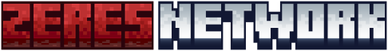

  

<b>Servidor de Minecraft en español</b> · Survival · SkyBlock · Zeres Cobblemon

<code>mc.zeres.fun</code>

---

### Cómo jugar

1. Descarga el **[Zeres Launcher](https://github.com/Zeres-Network/zeres-launcher/releases/latest)** (Windows).
2. Elige la instancia:
   - **Zeres Network**: Minecraft sin mods, para el survival y el skyblock.
   - **Zeres Cobblemon**: el modpack de Pokémon. El launcher lo instala y lo mantiene actualizado solo.
3. Pulsa **Jugar** y entras directamente al servidor.

Las dos instancias son el mismo servidor: solo cambia lo que lleva tu Minecraft.

### Repositorios

| Repo | Qué es |
|---|---|
| [zeres-launcher](https://github.com/Zeres-Network/zeres-launcher) | El launcher (Rust + Tauri). Código abierto: puedes ver exactamente qué hace en tu PC. |
| [zeres-network-modpack](https://github.com/Zeres-Network/zeres-network-modpack) | Las versiones del modpack de Cobblemon que descarga el launcher. |

> El launcher está en **beta**. Si algo falla, avísanos en Discord.
